# Entity-Relationship Diagram

The Smart Campus schema follows the academic hierarchy:

**College → Academic Session → Program → Class/Part → Section → Subject → Scheduled Lecture**

Primary keys are UUID v4 strings (`String(36)`). Timestamps are timezone-aware UTC. Money is `Numeric(12, 2)`.

```mermaid
erDiagram
    users ||--o| teachers : "1:1 profile"
    users ||--o| students : "1:1 profile"
    users ||--o{ sessions : "owns browser sessions"
    users ||--o{ audit_logs : "actor"
    users ||--o{ notifications : "receives"

    guardians ||--o{ students : "guardian of"

    academic_sessions ||--o{ programs : "offered in"
    academic_sessions ||--o{ student_enrolments : "enrolled in"
    academic_sessions ||--o{ timetable_entries : "scheduled in"
    academic_sessions ||--o{ examinations : "held in"
    academic_sessions ||--o{ fee_structures : "priced in"
    academic_sessions ||--o{ holidays : "closed on"

    programs ||--o{ class_levels : "has parts"
    programs ||--o{ subjects : "offers"
    class_levels ||--o{ sections : "has sections"

    teachers ||--o{ teacher_assignments : "assigned"
    subjects ||--o{ teacher_assignments : "taught"
    class_levels ||--o{ teacher_assignments : "to class"
    sections ||--o{ teacher_assignments : "to section"

    students ||--o{ student_enrolments : "enrols"
    students ||--o{ student_academic_history : "history"
    students ||--o{ board_examination_records : "prior board"
    students ||--o{ attendance_records : "attendance"
    students ||--o{ student_marks : "marks"
    students ||--o{ fee_invoices : "billed"
    student_enrolments ||--|| student_academic_history : "snapshot"

    timetable_entries ||--o{ attendance_records : "lecture attendance"
    teachers ||--o{ timetable_entries : "teaches"
    subjects ||--o{ timetable_entries : "subject of"
    classrooms ||--o{ timetable_entries : "held in"
    teachers ||--o{ teacher_attendance : "self attendance"
    teachers ||--o{ leave_records : "leave"

    examinations ||--o{ student_marks : "marks"
    subjects ||--o{ examinations : "examines"
    grading_policies ||--o{ grading_boundaries : "bands"
    grading_policies ||--o{ examinations : "versioned with"

    fee_structures ||--o{ fee_invoices : "generates"
    fee_invoices ||--o{ payments : "paid by"

    subjects ||--o{ study_materials : "material for"
    class_levels ||--o{ study_materials : "for class"

    users ||--o{ notices : "publishes"
    notices ||--o{ notifications : "dispatched as"
```

### Key integrity rules enforced

- `students.admission_number` — unique.
- `student_enrolments(session, section, roll_number)` — unique, so roll numbers never collide.
- `attendance_records(student, timetable_entry, date)` — unique, preventing duplicate attendance.
- `student_marks(exam, student)` — unique (indexed), preventing duplicate marks.
- `timetable_entries` — `end_time > start_time` check; teacher/classroom/class/section overlaps are rejected transactionally in the service layer.
- `grading_boundaries` — `max >= min`, `0..100`, contiguous and non-overlapping (validated in `validate_boundaries`).
- `examinations` — `passing_marks <= max_marks`.
- `fee_invoices` / `payments` — money as `Numeric(12,2)`; outstanding balance always derived from authoritative invoice + payment rows.
- Board records — `student + level` unique; `obtained <= total`.
