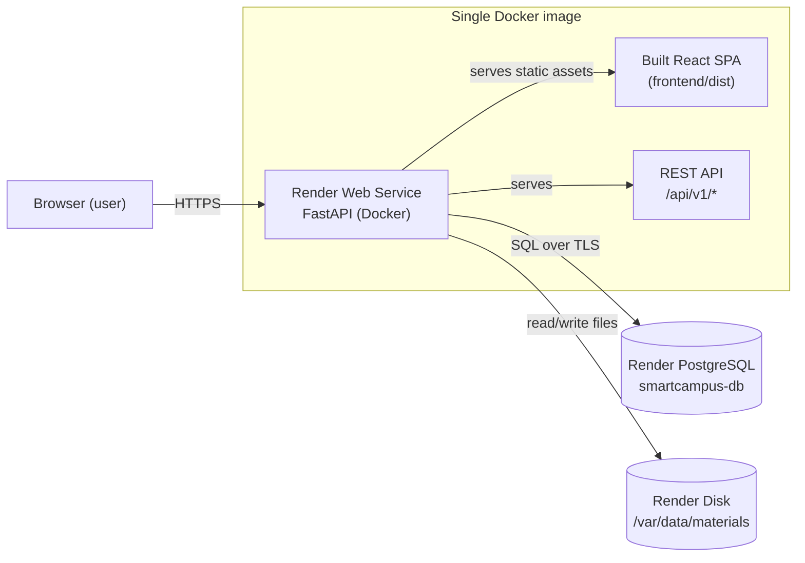

# Deployment

Smart Campus deploys through **one GitHub repository** to **Render**, serving the frontend and API from the same origin.

## Architecture

- **One Render Web Service** (`smartcampus`, Docker runtime) runs the multi-stage image: it builds the React frontend, installs backend dependencies, and launches `uvicorn`. The same process serves `/api/v1/*` and the static SPA (with SPA fallback) from one origin.
- **Render PostgreSQL** (`smartcampus-db`) is the persistent relational database. Render injects `DATABASE_URL`; the app normalizes `postgres://` → `postgresql+asyncpg://` automatically.
- **Render Disk** mounted at `/var/data` provides persistent local storage for uploaded study materials (`STORAGE_LOCAL_PATH=/var/data/materials`). Local application storage is **not** relied upon — uploads survive restarts and redeploys.
- Migrations run on every deploy via the container `CMD` (`alembic upgrade head` then `uvicorn`).
- Health checks hit `GET /health`.

## Provisioning with the blueprint

`render.yaml` is a Render Blueprint. To deploy:

1. Push the repository to GitHub.
2. In Render, choose **New → Blueprint** and select the repository. Render provisions:
   - a PostgreSQL database (`smartcampus-db`),
   - a Docker web service (`smartcampus`),
   - a 5 GB disk mounted at `/var/data`.
3. Render auto-generates `SESSION_SECRET_KEY` and `SEED_ADMIN_PASSWORD` (marked `sync: false, generateValue: true`). Note the generated admin password from the Render environment tab.
4. The first deploy runs migrations (`alembic upgrade head`, deriving the sync psycopg2 URL from `DATABASE_URL`) and then calls `bootstrap_admin()`, which creates the administrator from `SEED_ADMIN_EMAIL` / `SEED_ADMIN_PASSWORD` **only if it does not already exist** (it never resets an existing admin's password). Production never seeds synthetic demo students/teachers — `SEED_RESET_ON_START` is `false` in the blueprint, and demo seeding is disabled whenever `APP_ENV=production` regardless of that flag.
5. Visit the public URL (`https://smartcampus.onrender.com` by default) and sign in with the admin credentials. Update `CORS_ALLOWED_ORIGINS` to your final public URL.

## Production configuration checklist

| Concern | Setting |
| --- | --- |
| HTTPS | Render terminates TLS automatically |
| Secure cookies | `SESSION_COOKIE_SECURE=true`, `CSRF_SECURE=true` |
| SameSite | `lax` |
| Allowed origins | `CORS_ALLOWED_ORIGINS=https://<your-app>.onrender.com` |
| DB connection | injected from the Render database |
| Migrations | run on start (`alembic upgrade head`) |
| Health check | `/health` |
| Logging | `APP_LOG_LEVEL=INFO` (structlog) |
| Persistent files | Render Disk at `/var/data/materials` |
| Production build | `npm run build` inside the Docker image |

## File storage note

The local backend writes materials to a Render Disk, which is persistent across restarts and redeploys on paid plans. For the **free** tier (no persistent disk) or for very large volumes, switch to the S3 backend by setting `STORAGE_BACKEND=s3` and providing `STORAGE_S3_*` credentials — the storage interface is abstracted behind `StorageBackend`, so only `get_storage()` needs the real client wired in `app/services/storage.py`.

The deployed application must be tested using its **actual public URL** after the first successful deploy (sign in as each role, exercise a representative workflow per [docs/TESTING.md](TESTING.md)).
